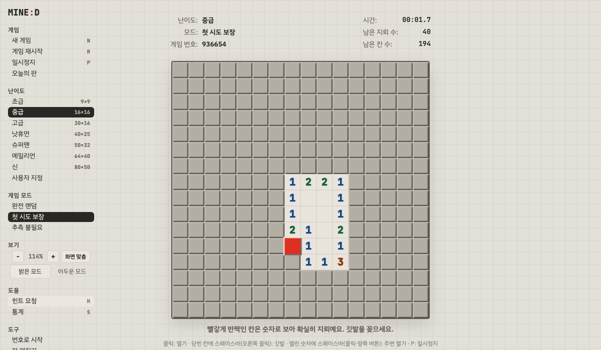

# MINE:D

설치 없이 브라우저에서 바로 하는 무료 지뢰찾기 게임입니다.

**[playmined.com에서 플레이하기 →](https://playmined.com)**

한국어 · [English](https://playmined.com/en/) · [日本語](https://playmined.com/ja/) · [中文](https://playmined.com/zh/)



## 주요 기능

- **7단계 난이도와 사용자 지정** — 9×9 초급부터 80×50 '신'까지
- **3가지 게임 모드** — 완전 랜덤, 첫 시도 보장, 추측 불필요
- **논리 힌트** — 다음에 둘 수 있는 확실한 수를 알려 주고, 추측이 필요한 판인지도 판별
- **오늘의 판** — 날짜마다 모두에게 같은 판, 기록 공유 가능
- **판 공유** — 게임 번호로 같은 판 다시 하기, 판 편집기로 만든 판을 링크로 공유
- **기록과 통계** — 난이도·모드별 최고 기록과 3BV/s (이 브라우저에만 저장)
- **어디서나 플레이** — 터치 조작, 앱 설치, 오프라인 실행, 어두운 모드, 키보드 조작 지원

## 난이도

| 난이도 | 판 크기 | 지뢰 수 |
|---|---|---:|
| 초급 | 9×9 | 10 |
| 중급 | 16×16 | 40 |
| 고급 | 30×16 | 99 |
| 낫휴먼 | 40×25 | 200 |
| 슈퍼맨 | 50×32 | 320 |
| 에일리언 | 64×40 | 512 |
| 신 | 80×50 | 760 |

## 조작법

| 입력 | 동작 |
|---|---|
| 클릭 | 칸 열기 |
| 오른쪽 클릭 / 스페이스바 | 닫힌 칸에 깃발 꽂기 |
| 열린 숫자 클릭 / 스페이스바 | 깃발 수가 맞으면 주변 칸 한 번에 열기 |
| 길게 누르기 (터치) | 깃발 꽂기 (설정에서 시간 조절) |

| 단축키 | 동작 |
|---|---|
| `N` / `F2` | 새 게임 |
| `R` | 같은 판 재시작 |
| `P` | 일시정지 |
| `H` | 힌트 |
| `S` | 통계 |
| `+` / `-` | 확대 / 축소 |

## 로컬에서 실행하기

빌드 과정이나 설치할 패키지 없이, 정적 파일 서버만 있으면 됩니다.

```sh
git clone https://github.com/kiheon2004/mined.git
cd mined
python3 -m http.server 8000
```

그다음 브라우저에서 <http://localhost:8000>을 엽니다.

## 수정하고 배포하기

원본은 루트의 `index.html` 하나입니다. `en/`, `ja/`, `zh/` 페이지와 `sitemap.xml`, `robots.txt`는 여기서 생성되므로 직접 고치지 마세요.

```sh
python3 build_langs.py   # index.html을 고친 뒤 항상 실행
```

`main` 브랜치에 푸시하면 GitHub Pages로 바로 배포됩니다. 도메인을 옮길 때는 `./set-domain.sh example.com`을 실행합니다.

## 테스트

Playwright로 실제 브라우저 엔진(Chromium, Firefox, WebKit)에서 게임을 띄워 확인합니다.

```sh
python3 -m venv .venv
.venv/bin/pip install -r tests/requirements.txt
.venv/bin/playwright install chromium
.venv/bin/pytest tests --browser chromium
```

세 엔진 실행, 검사 항목, 성능 측정 방법은 [tests/README.md](tests/README.md)를 참고하세요.

## 폴더 구조

```text
index.html             게임 전체 (HTML, CSS, JS가 한 파일에 있는 원본)
en/ ja/ zh/            언어별 페이지 (생성됨)
sw.js                  오프라인 지원용 서비스 워커
manifest.webmanifest   앱 설치 정보
build_langs.py         언어별 페이지·sitemap·robots 생성
set-domain.sh          사이트 도메인 변경
tests/                 브라우저 회귀 테스트와 성능 측정 도구
docs/                  README 이미지
```
